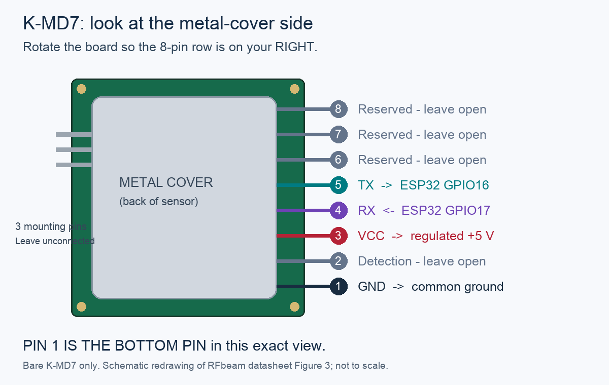

# K-MD7 + LilyGO T-SIM7080G-S3 bench test

Standalone PlatformIO project for your confirmed **RFbeam K-MD7** and
**LilyGO T-SIM7080G-S3** (ESP32-S3, 16 MB flash, OPI PSRAM).
This replaces the earlier T-Cell assumptions: use **RX16 / TX17**, not GPIO25/26.

## Wiring (power off first)

**Identifying the unlabeled pins:** Look at the side with the rectangular
metal cover (not the gold antenna patterns). Rotate the board so the row of
eight pins is on your RIGHT and the three mounting pins are on your LEFT.
In this exact view, **pin 1 is at the BOTTOM** of the eight-pin row. Count
upward: 1, 2, 3, 4, 5, 6, 7, 8. Turning the board over changes the view.
This is for the bare sensor, not the K-MD7-EVAL carrier board, which has
different connector numbering. If your hardware does not match, compare a
photo before applying power.



The diagram is a schematic redrawing of RFbeam Figure 3, page 4, verified
visually using the [manufacturer datasheet hosted by Novitronic](https://www.novitronic.com/Datenbl%C3%A4tter/Sensoren/K-MD7_Datasheet.pdf)
(revision B; the pin-function table agrees with revision D).

Use the radar's **X2 eight-pin connector**. Locate X2 pin 1 using Figure 3
on page 4 of the [RFbeam datasheet](https://rfbeam.ch/download/k-md7-datasheet/).
Do not infer pin numbering from wire colors or an arbitrary viewing direction.

| K-MD7 X2 | Connect to |
| --- | --- |
| 1 GND | T-SIM7080G-S3 GND and radar supply negative |
| 3 VCC | Regulated 5 V supply positive |
| 4 RX | T-SIM7080G-S3 **GPIO17** (ESP32 transmits) |
| 5 TX | T-SIM7080G-S3 **GPIO16** (ESP32 receives) |
| 2 detection output | Leave disconnected for this test |
| 6, 7, 8 | Leave disconnected |

X1 is mounting-only; leave electrically unconnected. Use a regulated 5 V
supply with at least 500 mA available for the radar (250 mA peak specified).
Power the T-SIM7080G-S3 through USB for the initial test; join grounds, but do not
tie the external supply positive to a USB-powered board rail. If you instead
use the board's VSYS pin, first verify its voltage and available current for
your exact revision and power mode. Do not assume it supplies regulated 5 V
from the battery. Do not power the radar from a GPIO.

UART signals are low-voltage logic, not RS-232 or RS-485. Connect the bare
module's UART directly as above; never put the 5 V supply on an ESP32 GPIO.
Keep bench wires short. GPIO numbers refer to printed IO labels, not header
position numbers. **Disconnect any camera before using GPIO16/17**: these
are shared camera signals. Disconnect the old radar from these pins too.
The modem uses separate GPIO4/5; do not use its TX/RX connections for the radar.
VSYS follows USB or battery voltage; it is not a regulated 5 V battery output.

## Everything needed for the bench test

- Your bare K-MD7 and T-SIM7080G-S3.
- A USB-C **data** cable and computer for programming the LilyGO.
- Regulated 5 V DC supply with at least 500 mA available for the radar;
  a USB 5 V supply with a screw-terminal breakout is one convenient option.
- Four 2.54 mm female jumper leads for radar GND, VCC, RX and TX, plus a
  ground jumper joining supply negative to the LilyGO GND. Choose the other
  jumper ends to match your board headers; install headers if absent.
- A small terminal block or breadboard to join the three grounds securely.
- A multimeter to check polarity and voltage before connecting the sensor.
- PlatformIO (for example its VS Code extension). No additional radar
  library, cellular SIM, or Wi-Fi setup is needed by this test firmware.

With everything off, connect the common ground and four radar signals from
the table. Leave the three mounting pins and unused electrical pins floating.
Disconnect any camera or previous radar. Before attaching VCC, measure the
supply: positive probe on supply +, negative probe on common ground should
read approximately +5 V. Then power the radar and connect LilyGO USB-C.
Never connect supply positive to GPIO16/17.

## USB dashboard (no Wi-Fi change)

Keep the board connected to this computer through its USB-C data port. Start:

```sh
cd /Users/himan/Desktop/Check/checkit-transportation-felix/kmd7-tsim7080g
/Users/himan/.platformio/penv/bin/python tools/usb_dashboard.py
```

Open **http://127.0.0.1:8765** on this computer. The server reads the uploaded
firmware's serial diagnostics, automatically reconnects when a single matching
ESP32 USB device appears, and clears live readings on disconnection or staleness.
For multiple boards, pass `--serial-port /dev/cu.YOUR_PORT`. Keep the server
running; Ctrl+C stops it. Close other serial monitors before starting it.
This localhost URL cannot be used from a different phone/computer.
No firmware reflash is needed. Requires Python with `pyserial`; the installed
PlatformIO Python already includes it. To use the `w` walking-test serial
command, stop this server, send it from your serial monitor, close the monitor,
and restart the server.

## Live dashboard

After uploading this firmware, join Wi-Fi **CheckIt-KMD7**, password
**RadarTest7**, and open **http://192.168.4.1**. Stay connected if your phone
warns that this network has no internet. This is a local link that only works
while connected to the board's Wi-Fi, including when the board runs on battery.

The page reports radar communication, target count, speed/direction, distance,
angle, last complete frame age, and frames containing detections. The latter
is not a unique vehicle count. Empty frames prove communication; a stale or
failed connection clears live targets. “Responding” does not measure supply
voltage. The dashboard stays accessible while the UART connection is failing.
The JSON endpoint is `/api/status`. No internet services or accounts are needed.

## Build and upload

Install PlatformIO, then run:

```sh
cd /Users/himan/Desktop/Check/checkit-transportation-felix/kmd7-tsim7080g
pio run -e tsim7080g
pio device list
pio run -e tsim7080g -t upload --upload-port /dev/cu.YOUR_PORT
pio device monitor -e tsim7080g --port /dev/cu.YOUR_PORT
```

Use the board's **USB-C port**, not the modem's Micro-USB port.
Replace `/dev/cu.YOUR_PORT` with the board port shown by `pio device list`.
Uploading replaces the firmware currently on that board. The dashboard firmware
was uploaded successfully to the connected ESP32-S3; serial monitoring confirmed
valid radar frames with zero targets during the check. If automatic upload fails, hold
BOOT, tap RESET, start upload, then release BOOT when it connects.

The source is `src/main.cpp`; UART pins are configured in `platformio.ini`.
The USB console uses 115200 8N1. The radar uses **115200 8E1** (even parity).
The reader sends INIT and then polls TDAT/DONE using GNFD. It reports target
ID, distance, signed km/h, absolute mph, direction, angle, and signal magnitude.

Expected console sequence:

```text
[VERSION] K-MD7_APP-...
[READY] Polling targets. ...
[TARGETS] 0
[FRAME] ...
```

An empty target list is a valid response and proves UART communication, not
that a moving target was detected. Aim the antenna face toward movement.
For a walking test, enter `w` in the monitor to lower the radar's minimum
speed filter to zero. This changes that sensor setting; record your previous
configuration first and restore it using the vendor tool after testing.
Other saved filters still apply. Enter `r` to reconnect.

If only `[WAIT]` appears, check supply voltage at the radar, common ground,
crossed RX/TX, connector numbering, board identity and baud/parity. Power-cycle
the radar and reset the ESP32 together if the radar was left at another baud.
A bootloader version is deliberately rejected. RESP errors are printed as
numeric codes; consult datasheet page 16.

This is a bench reader, polling about five times per second. It is not a
lossless vehicle counter and does not configure the deployment's speed/range
limits or integrate the sign, cellular modem, app, or cloud. Validate live
measurements and site settings before using readings for transportation alerts.

## Verification

Host decoder test (requires a C++ compiler):

```sh
c++ -std=c++11 -Wall -Wextra -Werror -I include tests/protocol_test.cpp -o /tmp/kmd7-protocol-test
/tmp/kmd7-protocol-test
```

Tests cover the vendor sample, negative speed, empty lists, fragmented input,
noise, invalid/oversized lengths, timeout reset and eight-target capacity.
Hardware operation still requires your connected board and radar.

## Sources

- [RFbeam K-MD7 datasheet, revision D](https://rfbeam.ch/download/k-md7-datasheet/), pages 2, 4, 11-17: power, pin numbering, UART and protocol.
- [LilyGO T-SIM7080G official repository](https://github.com/Xinyuan-LilyGO/LilyGo-T-SIM7080G): board settings, camera GPIO16/17, USB-C and VSYS behavior.
