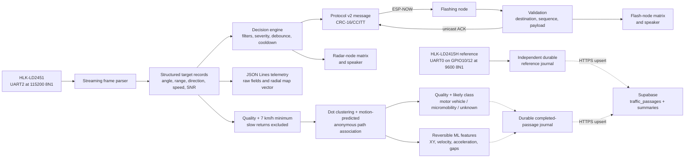
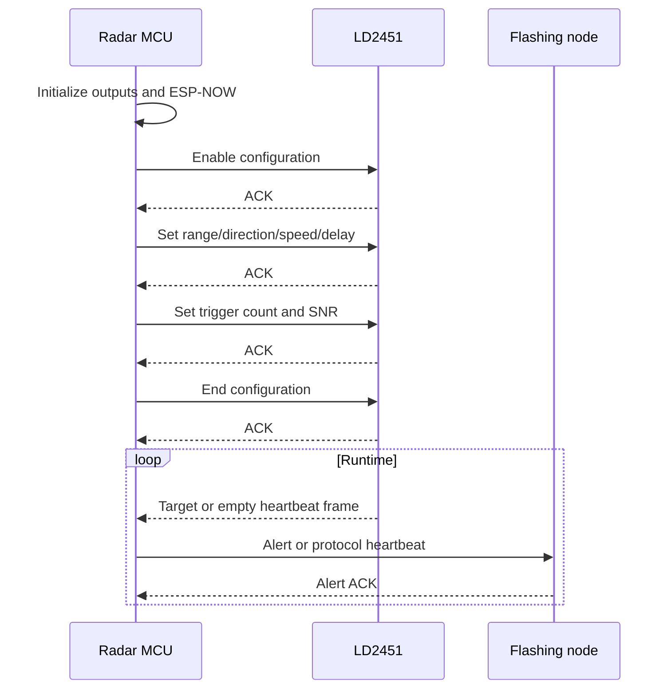
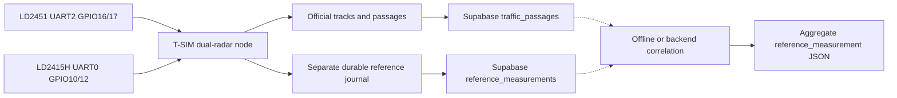

# Check-It Transportation V2 architecture

V2 uses one radar-node firmware image for three BLE-selected runtime modes. The
radar always owns the LD2451, traffic storage, and cloud upload. Roadside mode
disables warning outputs; radar-warning mode uses the local matrix/speaker; and
flashing-warning mode uses the separate flashing node with the radar output as
an acknowledgement-timeout fallback. Flashing nodes remain deliberately
simple: they validate commands, render the warning, acknowledge it, and fail
safe when the radar disappears.

## Runtime topology

The live warning path does not require Wi-Fi infrastructure, cellular service,
cloud storage, or the older Raspberry Pi components.

## Radar node

Target: LILYGO T-SIM7080-S3 (`radar_node` PlatformIO environment).

Responsibilities:

1. Configure UART2 on GPIO 16/17, leaving the onboard modem UART available.
2. Configure the LD2451 at boot, retry each command up to three times, and set
   its minimum reported speed to 7 km/h.
3. Parse the official `F4 F3 F2 F1` data frames without blocking.
4. Preserve angle, distance, direction, speed, and SNR for up to 16 targets,
   while flagging and reporting a larger radar count instead of overflowing.
5. Print one JSON object per target for logging and ML ingestion.
6. Evaluate all targets and select the highest-severity qualifying candidate.
7. Require consecutive qualifying reports and enforce an alert cooldown.
8. Drive the optional local MAX7219 display and amplified tone output.
9. In flashing-warning mode, send alerts and periodic heartbeats to the
   flashing-node tier.
10. Receive flashing-node ACKs and activate the local fallback when an alert
    is not acknowledged in time.
11. Reject returns slower than 7 km/h before the warning, tracking, dashboard,
    and storage paths, then cluster and associate the remaining observations.
12. Score completed paths as accepted, review, or rejected; conservatively
    classify accepted paths as motor vehicle, micromobility, or unknown before
    durable storage and upload.
13. Queue completed paths for an independent Wi-Fi task, retain calibration
    paths, and derive the existing `ten_minute_summaries` payload only from
    accepted paths.
14. Derive XY, velocity, acceleration, geometry, variation, and gap features
    without replacing raw radar fields or changing official counts.
15. Read the optional LD2415H on remapped UART0 GPIO10/GPIO12 and preserve its
    signed speed frames in a separate durable table. These observations never
    enter `DecisionEngine`, `TrafficTracker`, flashing decisions, or official
    10-minute volume.

The LD2451 target number remains an array position in one report. `TrafficTracker`
creates a new path ID using bounded nearest-neighbor association over predicted
Cartesian position, time, range, angle, speed, and direction. Constrained dots
are matched before ambiguous dots to reduce path-ID swaps. That ID is anonymous
and valid only with its random boot ID; it is not a person or device identity.

The 7 km/h cutoff is a deliberate capacity tradeoff for the LD2451's small
simultaneous-target budget. It removes ordinary walking-speed returns but is
not semantic pedestrian recognition: a runner can remain, and a very slow bike
can be excluded. If the radar rejects its minimum-speed configuration command,
the software cutoff still protects counting and storage, but it cannot recover
target slots already selected inside the radar.

### Direction and map vectors

The official protocol's direction table and worked example disagree about the
meaning of byte zero. `CHECKIT_LD2451_ZERO_DIRECTION_IS_APPROACH` makes that
mapping explicit and testable. Each physical radar must pass controlled
approach/away calibration before its data is training ground truth.
`CHECKIT_LD2451_ANGLE_SIGN` also records whether radar-relative angles are kept
or mirrored when converting a surveyed heading into a map bearing.

For a calibrated direction and surveyed radar heading, telemetry includes an
approximate signed radial velocity resolved into east/north components. Unknown
directions produce JSON `null` components. This prevents an invalid byte from
being silently treated as an away-moving vehicle.

## Flashing node

Target: generic external-antenna ESP32 (`flash_node` PlatformIO environment).

Responsibilities:

1. Put Wi-Fi station mode on the configured fixed ESP-NOW channel.
2. Copy receive-callback data into a FreeRTOS queue; do normal work outside the
   radio callback.
3. Validate packet length, magic, version, type, CRC, and destination.
4. Reject duplicate and stale sequences with 16-bit wraparound support.
5. Validate direction, severity, and bounded duration before enabling outputs.
6. Render the direction arrow, speed, blink rate, and severity tone.
7. Add the source MAC as an ESP-NOW peer and unicast an ACK.
8. Stop active outputs if no radar message arrives within the stale timeout.

## Shared libraries

| Library | Purpose |
| --- | --- |
| `CheckItConfig` | Site identity, radio channel, pins, thresholds, radar settings, and surveyed pose |
| `CheckItCore` | Target, direction, and warning-level domain types |
| `Ld2451Protocol` | Streaming data parser, configuration command builder, and ACK parser |
| `Ld2415hProtocol` | Independent signed-speed reference parser and configuration command builder |
| `DecisionEngine` | Pure warning evaluation plus debounce/cooldown state |
| `CheckItProtocol` | Packed ESP-NOW messages, CRC, constructors, and sequence tracking |
| `Max7219Display` | Dependency-free bit-banged four-module display driver |
| `WarningOutputs` | Nonblocking matrix, status, and tone state machine |
| `TrafficTracker` | Same-frame clustering, motion-predicted cross-frame association, path quality, and transparent likely classification |
| `TrafficFeatures` | Pure reversible coordinate/motion derivation and ML-ready path statistics |
| `CloudTelemetry` | Durable passage journal, accepted-track summaries, JSON batching, verified TLS, retries, and counters |
| `ReferenceTelemetry` | Separate durable LD2415H journal, verified-TLS batching, retries, and idempotent sample keys |

The platform-independent protocol, parser, and decision libraries are exercised
by the native test suite. Hardware-specific `Arduino`, UART, ESP-NOW, GPIO, and
timing code stays in each application's `main.cpp`.

## Startup sequences

### Radar node

If startup radar configuration fails, the node reports the failure and
continues with settings stored by the module. This keeps diagnostics available
without pretending the requested configuration succeeded.

### Flashing node

The flashing node initializes outputs, creates its receive queue, configures the
radio channel, and then waits. It does not activate from malformed, stale, or
misaddressed packets. Once it has seen a valid radar source, absence of all
valid radar messages for 12 seconds clears outputs and resets the failsafe.

## Radio trust boundary

Commissioning sends the 28-byte packet to the ESP-NOW broadcast MAC. The
`targetNodeId` still supports logical broadcast (`0`) or one flashing-node ID,
so unrelated nodes reject it.

CRC protects against accidental corruption but does not authenticate a sender.
Before use in an exposed public installation, provision peer MAC addresses,
switch the transport to unicast, and enable ESP-NOW encryption. That deployment
work requires site-specific keys and MAC inventory and is intentionally not
invented in the source.

## Timing and failure behavior

- LD2451 parsing is byte-streaming and nonblocking during normal runtime.
- Startup configuration commands have bounded ACK timeouts.
- Receive callbacks only enqueue fixed-size records.
- Displays and tones update from `millis()` without long blocking delays.
- Unsigned subtraction is used for durations so normal `millis()` wrap works.
- Alert sequence zero is skipped; receiving sequence logic supports `65535` to
  `0` wrap.
- Queue overflow drops new packets rather than blocking the radio callback.
- A missing flashing-node alert ACK activates the radar's local output after a
  bounded timeout; it never stalls radar parsing.
- Infrastructure Wi-Fi retries normally, resets the radio every five failed
  attempts, and restarts the radar after 15 continuous offline minutes.
- Supabase aggregation and HTTPS run in a separate low-priority task. The
  passage queue is bounded, retry timing is bounded, and failure never blocks
  radar parsing or warnings.

## Out-of-scope integrations

Wi-Fi Supabase upload is implemented. The T-SIM7080 modem remains available,
but cellular upload is not enabled because no carrier/APN contract has been
supplied. OTA updates and encrypted peer provisioning are also not implemented.
These integrations must remain independent of the local warning path.

## Independent LD2415H reference channel

The production `radar_node` reads both devices on separate hardware UARTs in
the same T-SIM7080-S3. The optional `ld2415h_reference` target remains only for
isolated bench testing with a separate generic ESP32. Neither arrangement
feeds LD2415H data into `DecisionEngine`, `TrafficTracker`, `FlashRouter`, or
official traffic volume. Its only job is to preserve and upload independently
measured signed speed for later, conservative comparison.

The LD2415H standard protocol is `V+ddd.d\r\n` for approach and
`V-ddd.d\r\n` for away at 9600 8N1. It supplies signed speed, not angle,
range, target count, or a stable object identifier. A reference sample can be
matched only when time, direction, and the set of active LD2451 paths make the
association unambiguous. Absence of a reference sample never rejects an
LD2451 micromobility passage.

The integrated T-SIM stores exact valid nine-byte measurement frames in a
separate FFat outbox before HTTPS upload. The standalone bench target uses
LittleFS. Supabase stores those samples separately.
`raw_radar_archives` is only an R2 object manifest; an authenticated R2 upload
service is still required before either node can claim end-to-end R2 archival.
